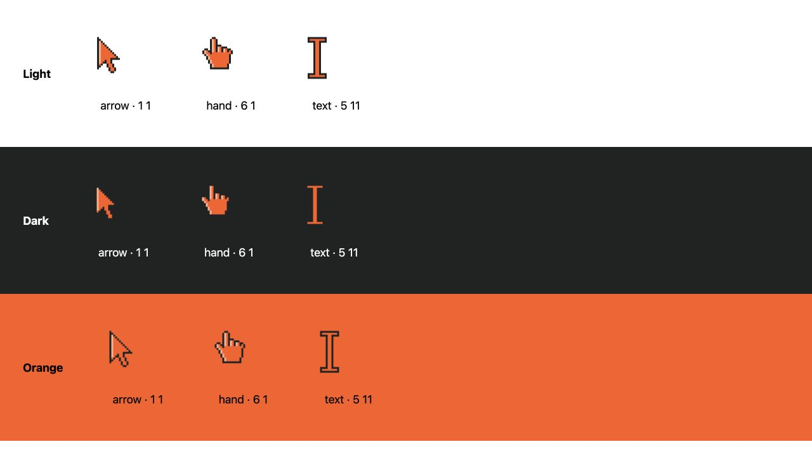

# Orange pixel cursors

Regenerate the three 32×32 SVGs and 64×64 nearest-neighbor PNGs with:

```sh
npm ci
node scripts/build-cursors.mjs
```

Hotspots (CSS pixels): arrow **1 1**, hand **6 1**, text **5 11**.
The I-beam is symmetric around x=5.5; 5 11 selects the upper-left central pixel of its even-width bar. The hand uses a closed stepped outline and upper-left highlights.



The screenshot shows the actual SVG assets enlarged 3× to inspect pixels, rather than OS cursor captures (which screenshots omit).

Fine, hovering pointers only. Links, buttons, form choice controls and existing custom clickable classes use the hand; disabled controls use the arrow. Text-entry fields use the I-beam. Portrait scripts are unchanged, so their inline cursor:none takes precedence after interaction initialization.

SVG is the preferred cursor, with density-aware 2× PNG fallback via image-set. A preceding SVG-only declaration covers browsers that reject image-set, with a native cursor as the final fallback.

Validation: Astro production build passed (14 routes). Integrated Chromium browser: all homepage links use hand; enabled/disabled button styles and contact text fields verified via computed styles; no console errors observed at that point. The contrast sheet was visually reviewed. Touch gating is enforced by the media query; real touch hardware and viewport emulation were not tested. Safari and Firefox were not available in this validation, so Safari fallback behavior remains unverified. Portrait loading was triggered, but full interactive 3D hover/drag validation remains pending.
