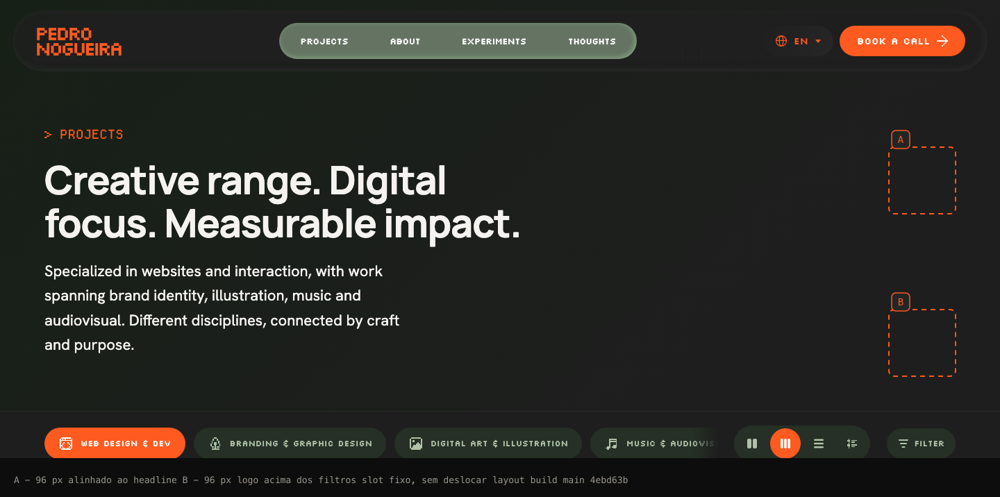
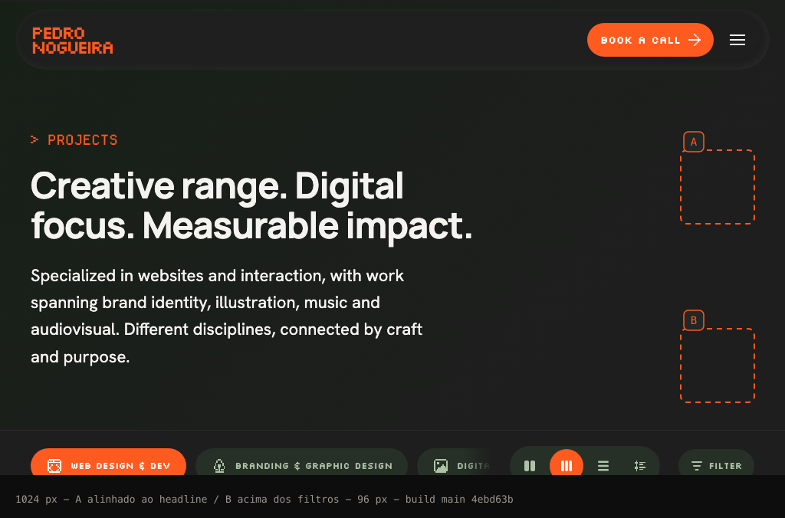

# Ícones animados de categoria — pesquisa e proposta

**Status (atualizado em 28/10/2026):** o Pedro escolheu **Opção A + Direção 1** e depois pediu uma escultura 3D extrudida, maior, em verde claro com dithering e resposta magnética. A implementação final está em `src/components/CategoryGlyph.astro` (Canvas 2D, 24×24×9 voxels, 256 px de buffer, transição de 480 ms), com o cabeçalho em duas colunas e subheadline na mesma largura da headline. O registro do sistema visual foi atualizado no `DESIGN.md`. Este documento permanece como registro da pesquisa e das alternativas descartadas.

Data: 28 de outubro de 2026 · Base: `main` @ `4ebd63b` (#60) · Escopo: `/projects`.

**Resumo da recomendação:** direção **1 (Bayer build-up)**, num slot fixo de **96×96 px no canto direito do cabeçalho** (Opção A), visível a partir de 1024 px, com Canvas 2D de baixa resolução (0 KB de dependência), montagem de 300 ms, troca de 340 ms e repouso estático. Todos os detalhes, alternativas e links estão abaixo.

---

## 1. Entendimento do pedido

A página Projects já tem seis controles de categoria (Web Design & Dev, Branding & Graphic Design, Digital Art & Illustration, Music & Audiovisual, Experiments e All). O pedido é acrescentar um ícone animado que corresponda à categoria selecionada, com linguagem de pixel art ou dithering, para enriquecer a descoberta sem competir com os projetos nem com a leitura.

Também foi pedido: pesquisar alternativas antes de implementar, comparar SVG/CSS, Canvas 2D e WebGL, propor 2–3 direções concretas e explicar como o ícone aparece, onde fica, como reage ao cursor e ao toque e o que acontece na categoria All. A implementação só começa depois da escolha do Pedro, e sem merge até pedido explícito.

Restrições que a proposta respeita: laranja e oliva existentes, ícones reconhecíveis, transição curta, desempenho em celular/tablet, pausa fora da viewport e em aba oculta, limpeza nas navegações Astro, `prefers-reduced-motion`, sem deslocar layout e sem ruído para leitores de tela.

## 2. O que já existe (e muda a proposta)

- Os cinco ícones de categoria **já existem**: `src/assets/icons/category-web|brand|art|music|experiment.svg`, todos 24×24, `fill="currentColor"`, `shape-rendering="crispEdges"`. Eles **já aparecem nos botões de categoria a 22 px** (`src/pages/projects.astro:23,50-56`). Ou seja: não é um sistema novo de ícones, é uma camada animada sobre a linguagem que já está na tela.
- All usa o ícone `grid2` (`projects.astro:56`), que pode continuar sendo o glifo de All.
- O projeto **já tem o pipeline de canvas 2D com Bayer**: `DitherIcon.astro` desenha em buffer reduzido, aplica a matriz Bayer 4×4, usa tinta `#FF5A1F`, `image-rendering: pixelated`, pausa por `IntersectionObserver`, `visibilitychange`, `prefers-reduced-motion` e limpa tudo via `onPageLoad` (`DitherIcon.astro:40,49-76,92-98,116-133`; `page-lifecycle.ts:2-42`).
- **`/projects` não usa WebGL hoje.** Já há três superfícies Canvas 2D na página: PixelTrail no cabeçalho, IconWaves e DitherIcon no CTA (`projects.astro:38,158,173`). Nenhum contexto GPU é inicializado nessa rota; PlayCanvas existe apenas na Home e no About.
- A troca de categoria é central em `update()` (`projects.astro:313-337`); hoje ela filtra e atualiza `aria-pressed`, **sem stagger nos cards**. O stagger de 300 ms / 35 ms / 210 ms pertence à troca de visualização (`projects.astro:358-384`). A animação do ícone deve conversar com esse tempo, não duplicá-lo.
- `?category=all|experiments|0-4` já é lido na inicialização (`projects.astro:354-357`); qualquer solução precisa continuar funcionando com deep links.

**Observação importante (fora do escopo, mas decisiva para o resultado):** o atributo `data-kind` está fixo por índice (`projects.astro:146`: `i === 4 || i === 5 ? "0,1" : "0"`). Com os seis projetos atuais, as categorias 2, 3 e 4 (Digital Art, Music, Experiments) **não encontram nenhum card** e caem no estado vazio. O ícone animado vai aparecer também nesse estado. Antes de implementar vale decidir: corrigir o mapeamento de categoria no mesmo PR, ou aceitar que o ícone seja o único conteúdo ao selecionar essas categorias.

## 3. Pesquisa técnica

### 3.1 Técnicas de dithering

| Técnica | Aparência | Custo | Adequação aqui |
|---|---|---|---|
| **Ordered / Bayer** (2×2, 4×4, 8×8) | Grade determinística, crosshatch/diagonal visível; a mais “pixel” | O(1) por pixel, LUT na memória; 4×4 = 16 níveis, 8×8 = 64 | **Alta.** Já é o que o DitherIcon usa; combina com o ícone 24×24 e com o laranja chapado. |
| **Blue noise** (void-and-cluster) | Stipple orgânico, sem periodicidade; parece impressão/riso | Textura pré-computada (64² CC0, 1–4 KB); geração é caríssima, então vem pronta | **Média-alta.** Ótima para a direção “print”, mas exige um asset a mais. |
| **Threshold / halftone** | Corte duro ou roseta de impressão | Muito baixo | Baixa sozinho; halftone fica borrado em ícone pequeno. |
| **Error diffusion** (Floyd–Steinberg) | Grão fino e orgânico | Sequencial, não paraleliza; refazer por frame cintila | Baixa para animação; só faria sentido como frames pré-assados. |

Regra de implementação: normalizar a matriz para 0–1 e usar um único comparador (`>` ou `>=`), com `m + 0.5` no caso de 8 bits, para não enviesar a cobertura para o claro (Surma documenta esse viés).

### 3.2 Pixelização e DPR

O caminho é renderizar pequeno e ampliar com vizinho mais próximo (`image-rendering: pixelated`; o canvas interno usa `imageSmoothingEnabled = false`). O tamanho do pixel aparente é `tamanho exibido / tamanho do buffer`, **independente do DPR**. Num slot de 96 CSS px:

- buffer 24×24 = 4 CSS px por célula (576 pixels) — leitura “pixel art” grossa, idêntica à grade dos SVGs;
- buffer 48×48 = 2 CSS px por célula (2.304 pixels) — leitura “dither” fina, ainda nítida.

Como 96 é múltiplo inteiro de 24 e de 48, o upscale é exato e não há pixels de larguras diferentes. Não é preciso redimensionar por `devicePixelRatio`: a textura é intencionalmente de baixa resolução. `pixelated` tem suporte amplo (Chrome 41+, Firefox 93+, Safari 10+; MDN BCD); `crisp-edges` é recente e desnecessário.

### 3.3 Caminhos de implementação

| Caminho | O que permite | Custo verificado | Fallback | Riscos |
|---|---|---|---|---|
| **SVG/CSS** | Dissolve por frames pré-computados, `steps()`, máscaras, `clip-path`, sprite/APNG; zero JS | 0 KB de biblioteca; ~8–16 frames por ícone (dezenas de KB de SVG/PNG) | Frame final estático | Sem threshold em runtime; sem blue noise; muitos assets; máscara suave não vira dither; cross-browser de filtros SVG é irregular |
| **Canvas 2D** | Máscara Bayer/blue noise em runtime, reveal de 300–360 ms, hover, controle total | **0 KB**; 576–2.304 px por frame; 1 `getImageData` por resize, buffers reutilizados; custo real desprezível para 96 px | SVG estático por categoria (ver §7) | Trabalho na main thread se alocar por frame; precisa de IO/visibility/cleanup |
| **WebGL/GLSL** | Threshold por fragmento, textura de blue noise, crossfade de dois ícones | 0 KB raw; **OGL 34,2 kB, regl 37,7 kB, three 184,9 kB, PixiJS 264,4 kB** (min+gzip, entradas completas, Bundlephobia em 28/10/2026) | Canvas 2D | Contexto GPU extra numa página que hoje não tem nenhum; Chromium limita ~16 contextos por renderer; perda de contexto no iOS; compile shader; complexidade desproporcional |

**Conclusão:** Canvas 2D. É o único caminho que entrega Bayer/blue noise real, com 0 KB de dependência, em um buffer minúsculo, e já tem precedente no repositório. WebGL só se justificaria para muitos ícones simultâneos ou tela cheia. SVG/CSS puro é o “plano B” mais barato e serve como fallback estático, mas não reproduz o efeito pedido sem inflar assets.

## 4. Onde o ícone pode viver

Testei o build atual em 1440 e 1024 (capturas estáticas; tema escuro e movimento reduzido). O cabeçalho de Projects tem a metade direita vazia em ≥1024 px, e a barra de filtros logo abaixo não tem folga: a rail de categorias rola, tem máscara de fade e ocupa `calc(100% - 328px)`. Colocar o ícone dentro da barra reduziria a rail e brigaria com os controles de visualização.

**Opção A — espécime no cabeçalho, alinhado ao headline (recomendada).** Slot fixo de 96×96 px, `position: absolute`, à direita do bloco de título, `pointer-events: none`, `aria-hidden`. Não desloca layout, não cobre texto em EN e não deve colidir nas traduções (o headline tem 23ch e o parágrafo 68ch, ambos ancorados à esquerda; o slot começa bem depois). Em 1440 e 1024 há espaço de sobra.

**Opção B — espécime logo acima da barra de filtros.** Mesmo tamanho, ancorado ao canto inferior direito do cabeçalho. Fica mais perto dos controles de categoria, mas pode parecer um controle solto e fica mais exposto a mudanças de altura do cabeçalho em traduções longas.

**Opção C — microanimação dentro do pill ativo (22 px).** Zero deslocamento e funciona em qualquer breakpoint, porém 22 px só comportam 2–3 níveis de dissolve; o dithering deixa de ser legível e vira um “piscar” sutil. Serve como complemento, não como a demonstração pedida.

**Breakpoints propostos:** exibir a partir de 1024 px (96 px); ocultar abaixo disso. Entre 769 e 1023 px o cabeçalho fica sem folga confiável; abaixo de 768 px a grade de categorias ocupa a largura toda, como nas capturas. No celular, os ícones estáticos de 22 px já cumprem o papel de identificar a categoria. Se o Pedro quiser presença no celular, a alternativa é reservar ~72 px de altura e colocar uma versão menor no fluxo (com deslocamento explícito, não acidental).

## 5. Três direções visuais

Todas usam o mesmo slot, a mesma tinta laranja e o mesmo Canvas 2D; mudam o tratamento do repouso, da entrada e da troca.

### Direção 1 — “Bayer build-up” (formar por pixels, repouso sólido)

- **Repouso:** glifo 24×24 chapado em laranja, perfeitamente parado. Opcional: 2–3 pixels de borda com variação muito lenta (a cada ~1,6 s), só enquanto visível — o “movimento discreto” do briefing.
- **Entrada:** 300 ms; os pixels do ícone aparecem em ordem Bayer (diagonal), como uma impressão sendo montada. Buffer 24×24 (pixels de 4 CSS px) ou 48×48 (2 px) para granulação mais fina.
- **Troca de categoria:** dissolve na mesma ordem em 120 ms, troca o glifo e remonta em 220 ms. Total 340 ms — alinhado ao stagger de 300 ms já aprovado, sem parecer carregamento.
- **Cursor:** parallax de 2 px no ícone inteiro (CSS) e 3–6 pixels de “faísca” perto do ponteiro; sem rAF contínuo, só durante o hover. Toque não depende disso.
- **All:** `grid2` monta do mesmo jeito, sem loop. Alternativa mais expressiva: placa 3×2 com os cinco glifos pequenos, todos montando juntos — comunica “tudo”, mas pode ficar ocupado.
- **Reduced motion:** frame final estático; troca instantânea.
- **Prós:** mais coerente com o sistema pixel existente, custo mínimo, leitura clara, sem loop. **Contras:** pode lembrar um “loading” se a duração passar de ~350 ms.
- **Referências:** Surma/Ditherpunk (ordered), Pixelarticons (grade 24), DitherIcon do próprio site.

### Direção 2 — “Blue-noise print” (dither como material)

- **Repouso:** o glifo não é chapado; é um stipple de blue noise com ~90% de cobertura e borda de 1 célula mais aberta, como tinta riso/impressão. Sem loop; no máximo um deslocamento de 1 px na textura a cada poucos segundos.
- **Entrada/troca:** varredura de threshold (320 ms) que “revela” o stipple da esquerda para a direita; na troca, a tinta antiga some e a nova re-imprime na mesma varredura.
- **Cursor:** a densidade do stipple sobe levemente perto do ponteiro (concentração de tinta), opcional.
- **All:** placa 3×2 com os cinco glifos em stipple (a expressão mais forte de “range”), ou `grid2` para manter a simplicidade.
- **Reduced motion:** stipple final estático.
- **Prós:** mais “impresso”, quente e autoral; diferencia o portfólio de efeitos digitais genéricos. **Contras:** exige textura CC0 de blue noise (1–4 KB); em 96 px e no tema claro pode ler como sujeira/ruído; precisa de teste de legibilidade em telas densas.
- **Referências:** Christoph Peters (blue noise), Surma (Obra Dinn: blue noise para ambiente), Vue Bits Dither Veil (softness/linger).

### Direção 3 — “Ink veil” (repouso nítido, transição com dither)

- **Repouso:** glifo chapado, nítido, absolutamente parado — o mais discreto dos três.
- **Troca:** uma faixa de “tinta” com borda ditherizada (1–2 células) atravessa o glifo em ~260 ms; o antigo se apaga atrás dela e o novo se re-tinta em seguida. Total ~450–480 ms.
- **Cursor:** nenhum efeito; teclado e toque só disparam a troca.
- **All:** `grid2` com a mesma faixa, sem placa.
- **Prós:** o mais premium e contido; ótimo se o Pedro quiser que o ícone seja quase invisível em repouso. **Contras:** menos “pixel art” no estado parado; transição um pouco mais longa; o efeito depende mais da faixa do que do ícone.
- **Referências:** Vue Bits (rim/linger), D:ual Space (contenção), Codrops CSS mask transitions.

| | Repouso | Entrada | Troca | All | Risco |
|---|---|---|---|---|---|
| **1. Bayer build-up** | sólido (+ shimmer opcional) | 300 ms montagem | 340 ms | `grid2` (ou placa) | parecer loading |
| **2. Blue-noise print** | stipple | 320 ms varredura | ~340 ms | placa de 5 glifos (ou `grid2`) | ruído no tema claro |
| **3. Ink veil** | sólido, imóvel | 300 ms | ~460 ms | `grid2` | menos personalidade parado |

## 6. Recomendação

**Direção 1 + Opção A** (espécime de 96 px alinhado ao headline, ≥1024 px), com um detalhe da Direção 2 apenas se o teste visual pedir: a granulação fina (buffer 48×48) na montagem, mantendo o repouso sólido. Motivos: usa o que o site já tem (`DitherIcon`, glifos 24×24), custa zero dependência, cabe no tempo do stagger aprovado, não tem loop em repouso e não disputa com os cards — o ícone fica no cabeçalho, acima da área de trabalho.

Sequência recomendada:

1. montagem de 300 ms na primeira aparição (ou imediatamente após a chegada da página, para não somar duas animações);
2. troca: 120 ms de dissolve + 220 ms de montagem, cancelável se o Pedro clicar rápido em outra categoria;
3. repouso: estático; shimmer opcional de 2–3 pixels de borda, pausado fora da viewport e em aba oculta;
4. All: `grid2` com a mesma montagem; sem loop. A placa de cinco glifos fica como opção explícita, não como padrão.

Se o Pedro preferir o ícone mais perto dos controles, a Opção B é viável com o mesmo componente. Se preferir presença no celular, a Opção C entra como microanimação do pill ativo — mas eu não a colocaria como demonstração principal.

## 7. Esboço de implementação (não executado)

- **Novo componente** `src/components/CategoryGlyph.astro` (markup + CSS + script), sem dependências. Markup: slot fixo 96×96, `aria-hidden="true"`, `pointer-events: none`, canvas + fallback estático.
- **Fallback estático:** os cinco SVGs de categoria e o `grid2` já existem; renderizá-los inline no slot e alternar por CSS a partir de um `data-active-category` no root (definido em `update()`). Assim, sem canvas ou com `prefers-reduced-motion`, o ícone correto aparece instantaneamente, sem depender de JS para desenhar. O canvas é a camada de enhancement por cima.
- **Fonte do desenho:** serializar o SVG inline visível (`XMLSerializer` → `Blob` → `Image`) ou usar `import.meta.glob` dos SVGs, como `Icon.astro` já faz; nenhum request extra em runtime.
- **Gatilho:** em `update()` (`projects.astro:313-337`), guardar a categoria anterior e disparar um `CustomEvent` (`portfolio:category-change`) só quando ela mudar. O componente escuta esse evento; deep links `?category=` e reset passam pelo mesmo caminho.
- **Buffer:** 24×24 (build-up grosso) ou 48×48 (granulação fina); `imageSmoothingEnabled = false`; `image-rendering: pixelated`; tinta `#FF5A1F`.
- **Ciclo de vida:** `onPageLoad` + `AbortController`/`scope.cleanup`; `IntersectionObserver` para pausar fora da tela; `visibilitychange` para aba oculta; `matchMedia('(prefers-reduced-motion: reduce)')` para desligar o canvas e trocar por CSS; cancelar rAF e revogar `Blob` URLs no cleanup.
- **Tempo:** rAF só durante os 300–360 ms de transição; frame final desenhado e loop encerrado. Nenhum requestAnimationFrame parado.
- **Placement:** CSS absoluto no `.projects-header` (Opção A), `z-index` acima do gradiente e abaixo do conteúdo textual; `display: none` abaixo de 1024 px.
- **Sem i18n nova:** o slot é decorativo e não tem texto; nenhuma linha nova no TSV. Nenhum `aria-label` extra.
- **Validação:** `npm run build`, `npm run i18n:check`, `node node_modules/typescript/bin/tsc --noEmit`, `git diff --check`; conferir 1440/1024/768/390, temas claro/escuro, teclado, toque, `prefers-reduced-motion`, aba oculta, navegação Astro para `/projects?category=all` e troca rápida entre categorias.
- **Esforço estimado:** uma sessão focada, ~150–220 linhas de componente/script + ~10 linhas em `projects.astro`; nenhuma alteração em `global.css` além do bloco scoped do componente.

## 8. Critérios de aceite (como a proposta os atende)

- Linguagem pixel/dither, laranja e oliva: glifos 24×24 existentes, tinta `#FF5A1F`, fundo do cabeçalho já em oliva/creme (claro) e verde-escuro (escuro).
- Ícones reconhecíveis: parte do sistema existente, sem redesenhar.
- Transição rápida: 300–360 ms, comparável ao stagger de 300 ms.
- Desempenho: 1 canvas, 576–2.304 px, zero custo em repouso, pausa fora da tela/aba; sem DPR extra.
- Ciclo de vida: `onPageLoad`/`scope.cleanup` como os outros efeitos.
- Reduced motion/fallback: SVG estático por categoria.
- Sem layout shift: slot absoluto, `pointer-events: none`; filtros e leitura intactos.
- Acessibilidade: decorativo (`aria-hidden`), sem novo foco, sem texto novo, sem substituir labels.
- Temas/toque/teclado: tinta e superfícies já testadas no site; nenhuma interação depende de hover.

## 9. Riscos e observações

1. **Categorias 2–4 estão vazias por causa do `data-kind` fixo** (`projects.astro:146`). O ícone vai animar para categorias sem projetos; decidir se o mapeamento é corrigido antes/junto.
2. **Capturas são estáticas** (build atual, tema escuro, movimento reduzido) e o mobile não foi validado em browser real nesta etapa. Antes de implementar, confirmar a composição no navegador, principalmente 768–1023 px e as traduções PT/ES/FR.
3. **Sem loop em repouso** é parte da recomendação; se o Pedro quiser “respiração” contínua, ela precisa ser limitada a poucos pixels e pausada fora da viewport.
4. **Nada de WebGL** nesta página: contexto GPU, perda de contexto no iOS e mais código para um efeito de 96 px não se pagam. Bibliotecas só aumentariam o bundle (34–265 KB).
5. **Não inventar dados**: a animação não introduz métricas, depoimentos ou conteúdo; é puramente decorativa.

## 10. O que preciso decidir com o Pedro

1. **Localização:** Opção A (cabeçalho, alinhado ao headline), Opção B (acima dos filtros) ou Opção C (microanimação nos pills)?
2. **Direção:** 1 (Bayer build-up), 2 (blue-noise print) ou 3 (ink veil)?
3. **Categoria All:** `grid2` com montagem (recomendado) ou placa 3×2 com os cinco glifos?
4. **Repouso:** totalmente parado ou shimmer muito discreto de 2–3 pixels?
5. **Breakpoint:** ocultar abaixo de 1024 px está ok, ou precisa de versão no celular?
6. **Mapeamento de categorias:** corrigir o `data-kind` no mesmo escopo ou deixar para outro PR?

Depois da escolha: implemento, valido e mostro o resultado. Sem merge sem pedido explícito.

## 11. Referências

Técnica e implementação (verificadas em 28/10/2026):

- [Surma — Ditherpunk](https://surma.dev/things/ditherpunk/) e [demo](https://surma.dev/lab/ditherpunk/) — comparação de ordered/blue noise/error diffusion.
- [Wikipedia — Ordered dithering](https://en.wikipedia.org/wiki/Ordered_dithering) — matrizes Bayer e viés de threshold.
- [Christoph Peters — Free blue noise textures](https://momentsingraphics.de/BlueNoise.html) — texturas CC0 e void-and-cluster.
- [Elena Kuznetsov — 8×8 Bayer-dither shader](https://pixelartcode.uk/posts/bayer-dither-nes-palettes) — shader GLSL inspecionável.
- [MDN — `image-rendering`](https://developer.mozilla.org/en-US/docs/Web/CSS/image-rendering) — `pixelated` e suporte.
- [MDN — Intersection Observer](https://developer.mozilla.org/en-US/docs/Web/API/Intersection_Observer_API), [`visibilitychange`](https://developer.mozilla.org/en-US/docs/Web/API/Document/visibilitychange_event) e [`prefers-reduced-motion`](https://developer.mozilla.org/en-US/docs/Web/CSS/@media/prefers-reduced-motion).
- [Astro — View transitions](https://docs.astro.build/en/guides/view-transitions/) — ciclo de limpeza nas navegações.
- [Lygia — amostra de dither em GLSL](https://github.com/patriciogonzalezvivo/lygia/blob/main/sample/dither.glsl) — referência de shader.
- [Chromium — limite de contextos WebGL](https://issues.chromium.org/issues/40939743) — por que não usar WebGL por ícone.
- [Bundlephobia](https://bundlephobia.com/) — tamanhos OGL 34,2 kB, regl 37,7 kB, three 184,9 kB, PixiJS 264,4 kB (min+gzip, entradas completas).

Referência visual:

- [Vue Bits — Dither Veil](https://vue-bits.dev/animations/dither-veil) — reveal com dither, padrões, softness/linger.
- [Visual Rambling — Dithering, Part 1](https://visualrambling.space/dithering-part-1/) — explicação animada de threshold map.
- [D:ual Space — Danci Shen](https://dancishen.com/playground/dualspace) — portfólio com dither contido e trocas de estado.
- [Pixelarticons](https://pixelarticons.com/) — grade 24×24 e escala inteira.
- [Dither It!](https://ditherit.com/) — ferramenta para testar paleta e densidade.
- [Codrops — CSS Mask Transition](https://tympanus.net/Tutorials/CSSMaskTransition/) — fallback por máscara sem WebGL (o site bloqueia curl; abrir no navegador).
